# Hotel Booking and Property Management System

A Persian-first booking and hotel operations system. Guests can request a stay; hotel staff confirm requests, assign rooms, manage housekeeping and maintenance, post operational folio charges, record offline payments, check guests out, and close business days. Guest requests require staff confirmation. The system does not process online payments or issue statutory tax invoices.

The product scope and behavior are defined in [prd.md](prd.md); completed and active work is tracked in [docs/implementation-tickets.md](docs/implementation-tickets.md).

## What it does

- Shows the hotel profile, active room types, amenities, availability, and nightly prices.
- Accepts a guest request with an idempotency key and holds available room-night inventory while the request awaits staff review.
- Gives named staff roles a private operational workspace for reservations, arrivals/departures, room readiness, housekeeping, maintenance, folios, service catalog, checkout, reports, and manual night close.
- Uses fictional hotel and staff seed data for local development. Guest and staff data should not be entered into a shared demo environment.

This is a booking-request workflow, not instant booking: staff confirmation is required, and no payment is collected.

## Interface

The Persian RTL interface uses a warm stone palette, deep garden-green accents, one Vazirmatn Variable font family, shared responsive typography and spacing tokens, and clear focus states across guest and staff pages. Tailwind theme tokens and shared shadcn components form the implementation standard; see the [design system](design.md) before changing page styling. A generated courtyard-and-orange-blossom emblem is shared by the guest site, staff workspace, footer, favicon, and Apple touch icon.

- **Guests** can explore the property, search by dates and party size, compare available rooms and prices, review a room, and submit a stay request. The request page explains that reception must confirm it and that no payment is taken online.
- **Staff** use a separate sign-in and role-protected operational workspace. Reception handles bookings and arrivals; housekeeping works assigned tasks; cashiers post folio charges and offline payments; managers oversee operations, maintenance, service catalog, folios, and night close; administrators also manage staff accounts and all capabilities. Authorization is enforced by the API.

The four WebP images and `hotel-mark.png` in `apps/web/public/images/hotel/` are generated conceptual artwork for the fictional Shiraz demo property. The same emblem supplies the browser and Apple icons in `apps/web/src/app/`. Replace the artwork with approved property photography and brand assets before using the site for a real hotel.

## Architecture

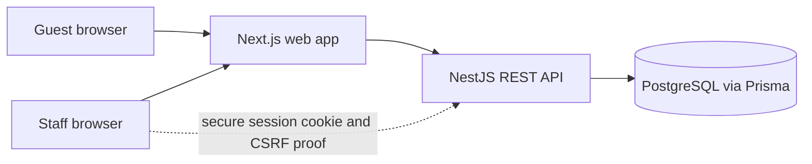

| Part       | Responsibility                                                                                                                                                                                       |
| ---------- | ---------------------------------------------------------------------------------------------------------------------------------------------------------------------------------------------------- |
| `apps/web` | Persian RTL guest search/request flow and responsive staff operations, including front desk, housekeeping, maintenance, folios, reports, and night close.                                            |
| `apps/api` | Versioned REST endpoints, booking and inventory rules, staff authentication and capability checks, housekeeping/maintenance, folios, audit history, and business-date operations.                    |
| PostgreSQL | Hotel and staff records, room-night inventory/assignments/blocks, bookings, housekeeping, maintenance, folio ledger, audit events, and close runs. Migrations are stored with the API Prisma schema. |

Guest requests are created as `PENDING_CONFIRMATION`. The API checks and holds every night in a stay transactionally. Staff confirmation converts the hold to booked inventory; rejection, cancellation, or expiry releases it. Staff sessions use HTTP-only cookies. State-changing staff requests also require a CSRF token. The API accepts Gregorian ISO date-only values; the Persian UI presents Jalali dates.

## Staff roles and operating workflows

All staff use accounts created by an administrator. First sign-in requires password replacement. The API checks each protected action against the account's named role.

| Role             | Main access                                                                                                                                                                                          |
| ---------------- | ---------------------------------------------------------------------------------------------------------------------------------------------------------------------------------------------------- |
| **ADMIN**        | All operational capabilities, staff account administration, inventory and room catalog, folios, payments, checkout, reports, and night close.                                                        |
| **MANAGER**      | Booking and room operations, inventory and catalog, housekeeping oversight, maintenance blocks, folio adjustments and service catalog, settlement overrides with a reason, reports, and night close. |
| **RECEPTIONIST** | Guest requests and front desk stays, room board, housekeeping/maintenance requests, folio viewing, and checkout when its balance rules allow.                                                        |
| **HOUSEKEEPER**  | Assigned room tasks, housekeeping updates, and maintenance requests. Task access is limited to the signed-in worker's assignments.                                                                   |
| **CASHIER**      | Folio viewing, ledger charges and offline payment entries, room-number display, and checkout.                                                                                                        |

Typical operating flow:

1. A guest searches dates and submits a request. The request holds availability while it awaits staff review. Confirmation by reception or a manager turns it into a reservation; rejection, cancellation, or expiry releases the hold.
2. Reception reviews arrivals, assigns available rooms, and checks guests in after the room is inspected. Dirty, blocked, or conflicting rooms cannot be used for check-in. Room moves keep dated assignment history.
3. Housekeeping completes assigned room tasks and inspections. Reception and housekeeping can raise maintenance requests; managers/admins manage maintenance blocks that remove rooms from availability.
4. Staff post catalog services to the operational folio. Cashiers/managers/admins can record cash, terminal, bank transfer, or other offline settlement details. The app records the payment; it never moves money or stores cardholder data.
5. Reception/cashier/manager/admin can check out when the folio is settled. A manager/admin may use the reasoned on-account override. Checkout finalizes the folio and marks the room dirty for housekeeping. The authenticated print view produces an operational statement.
6. A manager/admin reviews the business-date preview and manually closes the day. Resolve blockers, confirm the displayed date and accommodation total, and use the [close runbook](docs/booking-day-close-operations.md) for rollback/retry guidance.

The service catalog, private folios, staff reports, and business-day close are staff-only. Public booking responses do not include staff notes, guest contact details, or folio data.

## Requirements

- Node.js 22.19 or newer
- Corepack and pnpm 10.26.2
- Docker Desktop with Docker Compose for the local PostgreSQL service

## Set up a clean checkout

Run these commands from the repository root. The commands below use PowerShell; on macOS/Linux, replace `Copy-Item .env.example .env` with `cp .env.example .env`.

```powershell
corepack enable
corepack prepare pnpm@10.26.2 --activate
Copy-Item .env.example .env
```

Edit `.env` before starting the database:

- Set a private local `POSTGRES_PASSWORD` and use the same value in `DATABASE_URL`.
- Set `DEMO_ADMIN_EMAIL` and `DEMO_ADMIN_PASSWORD` for the fictional local staff account. The seed reads these variables from `.env`.
- Keep `.env` private. It is ignored by Git; do not use the example or demo credentials on a shared or public deployment.

Then install, start PostgreSQL, migrate, and seed:

```powershell
pnpm install --frozen-lockfile
pnpm db:up
pnpm --filter @hotel/api run prisma:generate
pnpm --filter @hotel/api run prisma:migrate:deploy
pnpm --filter @hotel/api run prisma:seed
```

The seed is safe to rerun and creates fictional hotel catalog, inventory, and a development-only staff account from the environment variables. Migrations are explicit so app startup never changes a database schema unexpectedly.

The example database publishes on port `5433` to avoid a local PostgreSQL server on `5432`. If that port is occupied, set `POSTGRES_PORT` and the matching port in `DATABASE_URL` before `pnpm db:up`.

## Run the apps

```powershell
pnpm dev
```

Open the guest app at [http://localhost:3000](http://localhost:3000). The API is at `http://localhost:4000`; product endpoints are under `/api/v1`.

You can also start the apps independently:

```powershell
pnpm dev:web
pnpm dev:api
```

In development and test, Swagger UI is available at [http://localhost:4000/api/docs](http://localhost:4000/api/docs). The OpenAPI JSON document is at [http://localhost:4000/api/docs-json](http://localhost:4000/api/docs-json). API docs are not registered in production.

Swagger is an API reference for staff login; its Try it out request is expected to receive `403` because the docs page is served from the API origin while the login guard allows only the configured `WEB_ORIGIN`. Use `/staff/login` for interactive browser sign-in. A non-browser client must send both `Origin` and `Referer` matching `WEB_ORIGIN`.

Health endpoints remain outside the versioned prefix: `GET /health/live` checks the process and `GET /health/ready` checks the database. Readiness returns a sanitized `503` response with setup guidance when PostgreSQL is unavailable.

## API overview

| Method       | Path                                                                   | Purpose                                                                                                   |
| ------------ | ---------------------------------------------------------------------- | --------------------------------------------------------------------------------------------------------- |
| `GET`        | `/api/v1/hotel`                                                        | Read the public hotel profile.                                                                            |
| `GET`        | `/api/v1/room-types`                                                   | List active public room types.                                                                            |
| `GET`        | `/api/v1/availability?checkIn=2027-05-01&checkOut=2027-05-04&guests=2` | Search available rooms and prices. Dates use Gregorian `YYYY-MM-DD`; checkout is exclusive.               |
| `POST`       | `/api/v1/bookings`                                                     | Submit a pending request. Include an `Idempotency-Key` header and the request body documented in Swagger. |
| `POST`       | `/api/v1/staff/auth/login`                                             | Sign in with the local staff account; sets staff and CSRF cookies.                                        |
| `GET`        | `/api/v1/staff/auth/me`                                                | Read the current staff profile and rotate the CSRF token.                                                 |
| `POST`       | `/api/v1/staff/auth/logout`                                            | Revoke the current staff session.                                                                         |
| `GET`        | `/api/v1/staff/bookings`                                               | Filter and paginate guest requests; requires an authorized staff session.                                 |
| `GET`        | `/api/v1/staff/inventory`                                              | Read room-night inventory; requires staff session.                                                        |
| `PUT`        | `/api/v1/staff/inventory`                                              | Set capacity and nightly price; requires inventory capability and CSRF proof.                             |
| `GET`        | `/api/v1/staff/rooms/board`                                            | Read room status, assignments, and readiness; role-filtered.                                              |
| `GET`/`POST` | `/api/v1/staff/housekeeping/**`                                        | Work queues, tasks, inspection, and room readiness; role-filtered.                                        |
| `GET`/`POST` | `/api/v1/staff/maintenance/**`                                         | Maintenance requests and room blocks; role-filtered.                                                      |
| `GET`/`POST` | `/api/v1/staff/folios/**`                                              | Operational ledger, services, payments, checkout, and authenticated print data.                           |
| `GET`/`POST` | `/api/v1/staff/operations/**`                                          | Business-date reports, night-close preview, and manual close.                                             |

The staff panel also exposes request detail, confirm, reject, cancel, staff-account administration, room/assignment changes, housekeeping and maintenance workflows, folio/service-catalog operations, and reports. Role requirements, request and response schemas, error formats, and the remaining routes are described in Swagger. API validation rejects unknown body fields; errors include a stable code, safe message, and request ID. Authenticated staff responses use private no-store cache headers; state-changing requests require CSRF proof.

## Local demo flow

1. Start the database and apps using the setup steps above.
2. On the guest site, search a stay and open a room’s request form.
3. Submit a fictional guest request. The confirmation page shows that it is awaiting staff review.
4. Open `/staff/login` and sign in with the local `DEMO_ADMIN_EMAIL` and `DEMO_ADMIN_PASSWORD` values from `.env`.
5. Open the request in the staff panel and confirm or reject it. For PMS flows, create separate fictional staff accounts for the needed roles from **Staff → Staff accounts**; review arrivals, assign an inspected room, complete housekeeping tasks, post a test service, record a test offline payment, check out, then review and close the business day as manager/admin.

The seeded account and demo data are for local testing only. A guest request is not confirmed until staff accept it.

## Operating limits and legal boundary

- Payments are manual records only. There is no online payment gateway, card processing, bank reconciliation, email/SMS notification provider, or external identity integration.
- Printed folios are operational statements, not statutory tax invoices, receipts, or proof of fiscal compliance. The app does not calculate jurisdiction-specific taxes, fees, or legal rates. Confirm local accounting and invoice requirements before using real guest or payment data.
- Night close is manager/admin initiated; no automatic close scheduler is installed. The existing booking-expiry worker runs in-process, and the supported deployment is a single API instance until that worker has distributed coordination.
- Reports filter stays and ledger totals by business date. Readiness, active room/block state, open balances, and pending queues are current-state values; historical snapshots are not retained for those measures.
- The property business date uses the configured hotel timezone (seeded demo: `Asia/Tehran`). API date-only inputs use Gregorian `YYYY-MM-DD`; staff and guest screens display Persian Jalali dates.
- Before real use, configure deployment TLS, trusted proxy addresses, rate limits at the production edge, security headers, secret storage/rotation, access monitoring, and an incident/restore procedure. Local checks do not verify a live proxy/CDN or production login-limiter topology.

## Database backup and restore expectations

The local Compose named volume persists PostgreSQL data when the container stops; it is not a backup. This repository does not schedule or manage production backups. Before using real data, operators must define encrypted off-host backups, retention, access controls, recovery point/time objectives, and regular restore drills. PostgreSQL backups should use `pg_dump` custom format and be restored with `pg_restore` into a separate, empty recovery database first. Verify restored data and migrations with the release checks before directing application traffic to it. Never test restore commands against the active production database.

## Screenshots

The guest and staff screenshots below were regenerated from the current Tailwind and shadcn interface. They use fictional demo data and conceptual hotel imagery. The PMS workflow screenshots show additional staff journeys captured by the release Playwright run.

### Guest experience

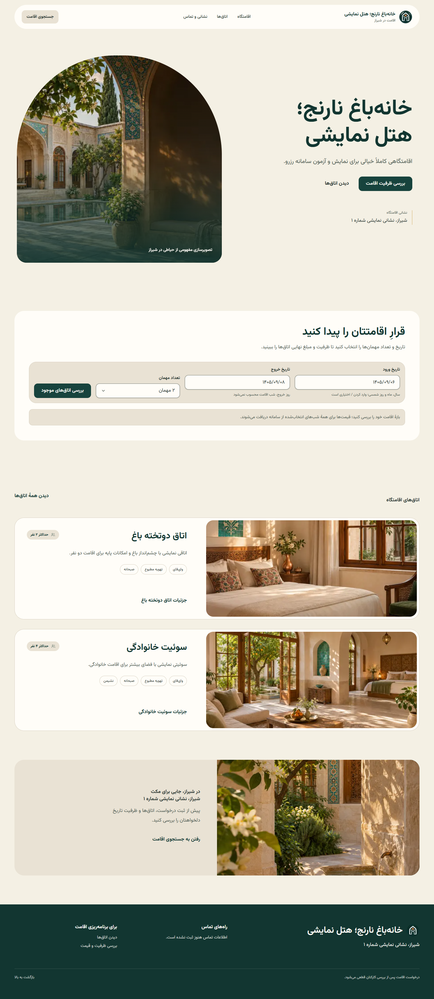

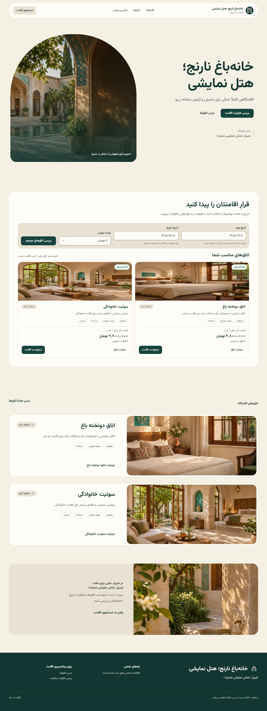


Room detail: [garden double](docs/screenshots/public-room-detail.png). Mobile: [homepage](docs/screenshots/public-home-mobile.png), [availability results](docs/screenshots/public-results-mobile.png), and [booking form](docs/screenshots/public-booking-mobile.png).

### Staff workspace

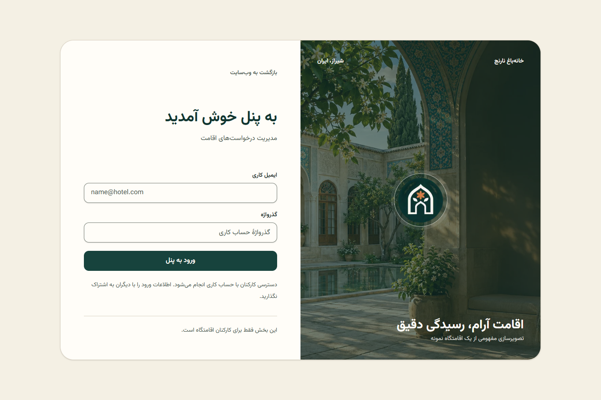

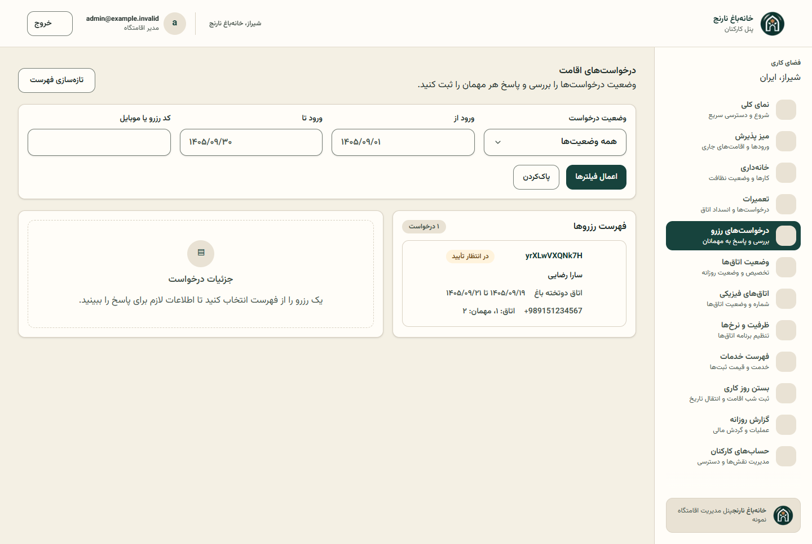

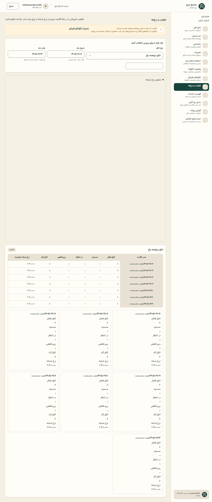

Mobile inventory: [staff inventory view](docs/screenshots/staff-inventory-mobile.png).

### PMS workflows

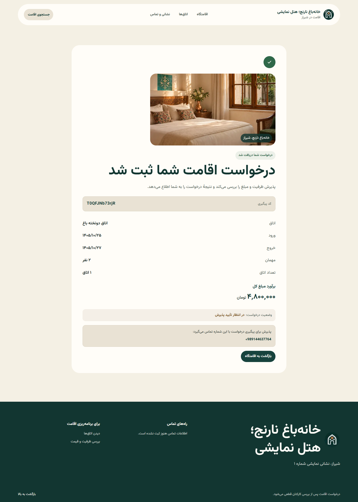

Mobile: [guest confirmation](docs/screenshots/pms-guest-confirmation-mobile.png).

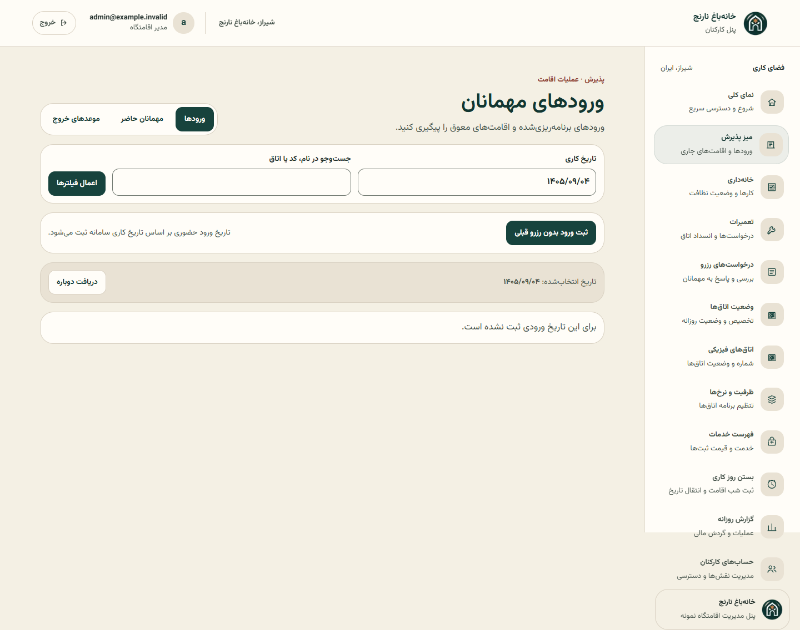

Mobile: [reception arrivals](docs/screenshots/pms-front-desk-arrivals-mobile.png).

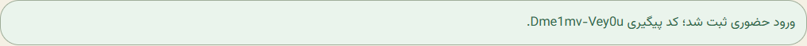

Mobile: [walk-in confirmation](docs/screenshots/pms-front-desk-walk-in-mobile.png).

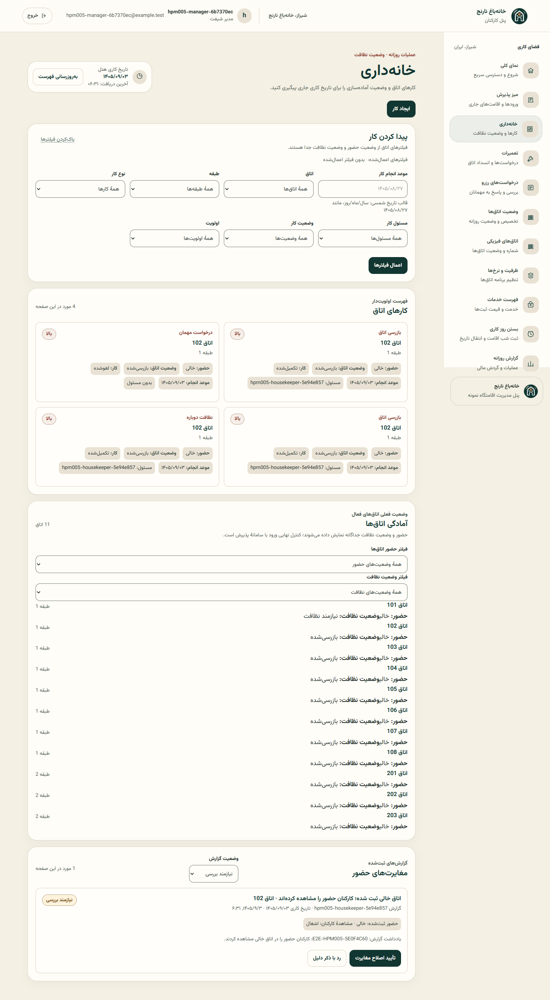

Mobile: [housekeeping task board](docs/screenshots/pms-housekeeping-board-mobile.png). Maintenance: [desktop](docs/screenshots/pms-maintenance-blocks.png), [mobile](docs/screenshots/pms-maintenance-blocks-mobile.png).

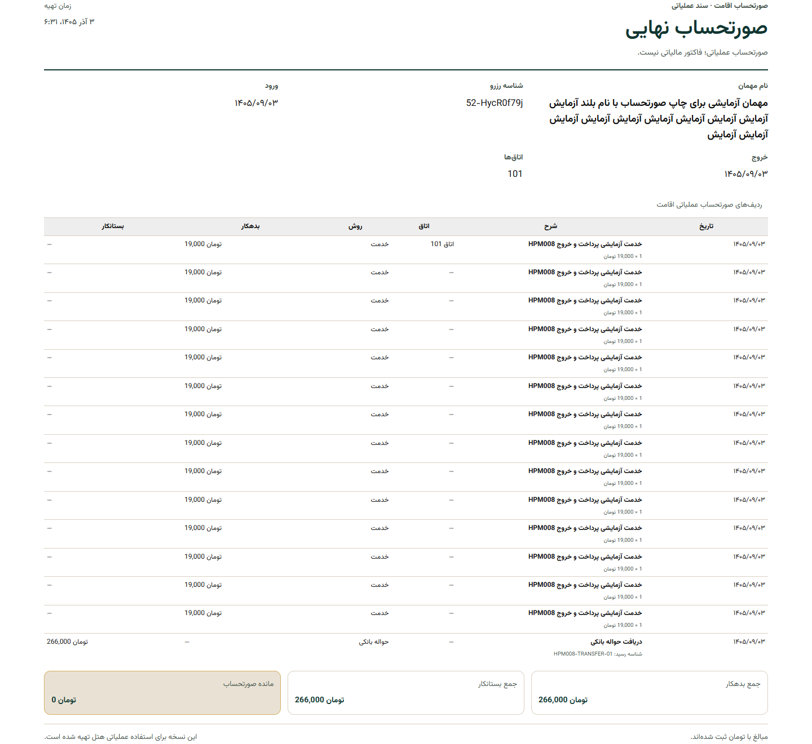

Narrow print preview: [folio print](docs/screenshots/pms-cashier-folio-print-narrow.png).

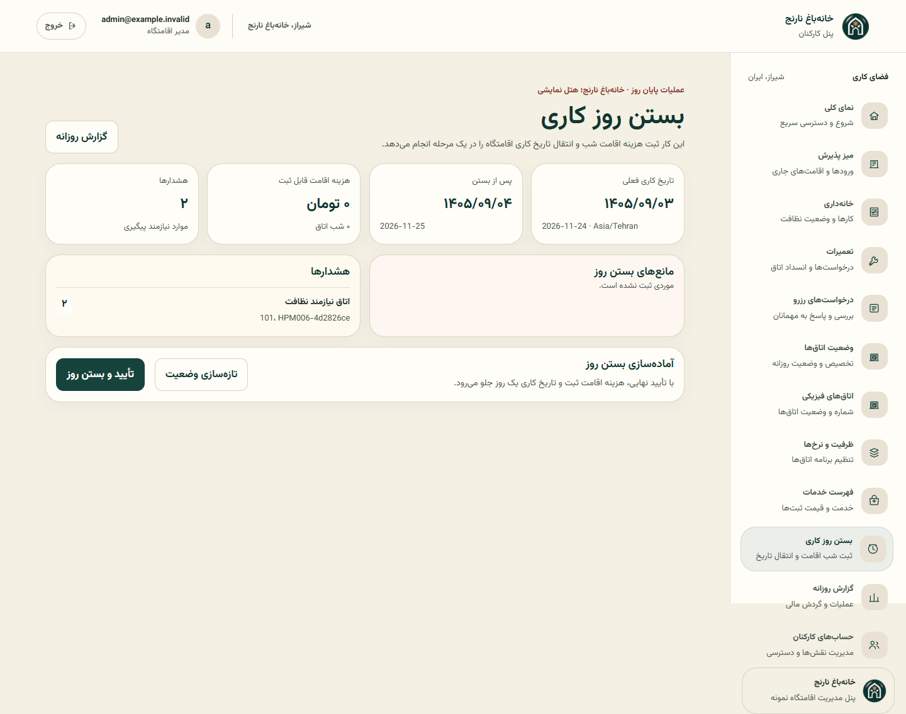

Mobile: [night-close preview](docs/screenshots/pms-night-close-mobile.png). Daily report: [operations report](docs/screenshots/pms-daily-report.png).

To regenerate the screenshots, start the apps, seed the fictional local staff account, install Playwright Chromium, and run:

```powershell
pnpm --filter @hotel/web exec playwright install chromium
pnpm --filter @hotel/web exec node scripts/capture-demo-screenshots.mjs
```

If Playwright's Chromium is unavailable but Chrome is installed, set its executable path before running the script:

```powershell
$env:DEMO_BROWSER_EXECUTABLE = 'C:\Program Files\Google\Chrome\Application\chrome.exe'
pnpm --filter @hotel/web exec node scripts/capture-demo-screenshots.mjs
```

The script reads development staff credentials from process environment or `.env` without printing them. It captures the guest homepage, availability, room detail, booking request, staff sign-in, requests, and inventory pages, along with mobile views for the main guest and inventory flows. It revokes its temporary staff session when finished.

## Tests and release checks

Run the complete documented release gate with:

```powershell
pnpm check
```

The release gate runs format checking, lint, type checking, unit/component tests, PostgreSQL-backed API integration/coverage, seed validation, web coverage, desktop/mobile Playwright, API end-to-end tests, and production builds. `DATABASE_URL` must use an isolated local PostgreSQL database name ending in `_test`; the check script derives its connection details and creates a unique database for API coverage, Playwright, and API end-to-end tests on each run. It does not reset or drop existing databases. The new test databases remain in PostgreSQL for manual cleanup. The release gate uses only fictional test data and does not require production credentials. Set `HBE_E2E_CHROMIUM_EXECUTABLE_PATH` when using installed Chrome instead of Playwright's bundled Chromium.

Useful focused commands:

```powershell
pnpm --filter @hotel/api run test:database
pnpm --filter @hotel/api run test:e2e
pnpm --filter @hotel/web run test:e2e
pnpm --filter @hotel/api run test:coverage
pnpm --filter @hotel/web run test:coverage
```

Coverage output is written beneath each app’s `coverage/` directory and is ignored by Git. The API OpenAPI contract test runs as part of the API end-to-end suite and verifies the development docs page, versioned routes, schemas, staff cookie security, CSRF, and idempotency documentation.

## Troubleshooting

- **Database readiness returns `503`:** Start PostgreSQL with `pnpm db:up`, check `DATABASE_URL`, then open `http://localhost:4000/health/ready` again.
- **Database authentication fails:** The password in `DATABASE_URL` must match `POSTGRES_PASSWORD` in `.env`. Compose preserves its named volume; changing the password variable does not change an existing database role password automatically.
- **Prisma reports pending migrations:** Run `pnpm --filter @hotel/api run prisma:migrate:deploy`, then rerun the seed if needed.
- **Demo sign-in fails:** Confirm `DEMO_ADMIN_EMAIL` and `DEMO_ADMIN_PASSWORD` are set before `pnpm --filter @hotel/api run prisma:seed`, then use those same values at `/staff/login`.
- **Swagger returns `404`:** Swagger is available only when the API runs with `NODE_ENV=development` or `NODE_ENV=test`; check the API origin and open `/api/docs`.
- **Port `5433` is taken:** Set another `POSTGRES_PORT` and update the port in `DATABASE_URL` to match.

Stop the local database with:

```powershell
pnpm db:down
```

`pnpm db:down` stops the container but keeps the named PostgreSQL volume so local data remains available for the next run.
