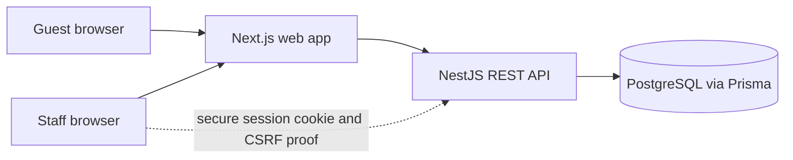
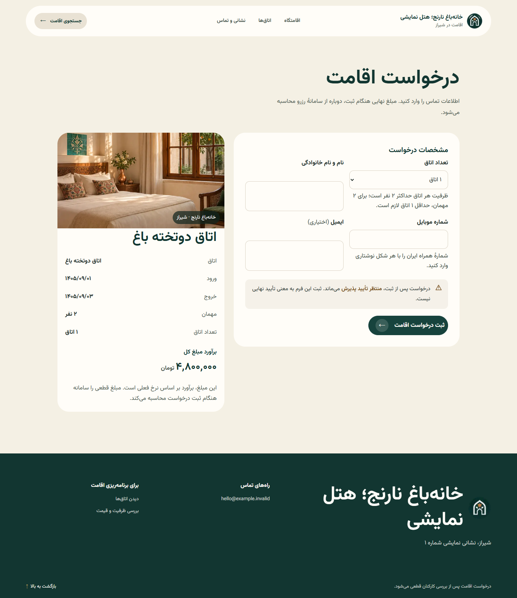

# Hotel Booking Engine

A Persian-first hotel booking request system. Guests can search rooms and send a stay request. Hotel staff review each request and must confirm it before it becomes a reservation. The system does not process online payments.

The product scope and behavior are defined in [prd.md](prd.md); completed and active work is tracked in [docs/implementation-tickets.md](docs/implementation-tickets.md).

## What it does

- Shows the hotel profile, active room types, amenities, availability, and nightly prices.
- Accepts a guest request with an idempotency key and holds available room-night inventory while the request awaits staff review.
- Lets staff sign in, filter and process requests, and lets administrators manage room-night capacity and prices.
- Uses fictional hotel and staff seed data for local development. Guest and staff data should not be entered into a shared demo environment.

This is a booking-request workflow, not instant booking: staff confirmation is required, and no payment is collected.

## Interface

The Persian RTL interface uses a warm stone palette, deep garden-green accents, one Vazirmatn Variable font family, shared responsive typography and spacing tokens, and clear focus states across guest and staff pages. A generated courtyard-and-orange-blossom emblem is shared by the guest site, staff workspace, footer, favicon, and Apple touch icon.

- **Guests** can explore the property, search by dates and party size, compare available rooms and prices, review a room, and submit a stay request. The request page explains that reception must confirm it and that no payment is taken online.
- **Staff** use a separate sign-in and operational workspace for the overview, booking requests, and room-night inventory. Receptionists handle requests; administrators can also edit nightly capacity and prices.

The four WebP images and `hotel-mark.png` in `apps/web/public/images/hotel/` are generated conceptual artwork for the fictional Shiraz demo property. The same emblem supplies the browser and Apple icons in `apps/web/src/app/`. Replace the artwork with approved property photography and brand assets before using the site for a real hotel.

## Architecture



| Part       | Responsibility                                                                                                                   |
| ---------- | -------------------------------------------------------------------------------------------------------------------------------- |
| `apps/web` | Persian RTL guest search and request flow, plus staff booking and inventory pages.                                               |
| `apps/api` | Versioned REST endpoints, validation, availability and booking rules, staff authentication, and inventory operations.            |
| PostgreSQL | Hotel, room types, room-night inventory, booking requests, and staff sessions. Migrations are stored with the API Prisma schema. |

Guest requests are created as `PENDING_CONFIRMATION`. The API checks and holds every night in a stay transactionally. Staff confirmation converts the hold to booked inventory; rejection, cancellation, or expiry releases it. Staff sessions use HTTP-only cookies. State-changing staff requests also require a CSRF token. The API accepts Gregorian ISO date-only values; the Persian UI presents Jalali dates.

## Requirements

- Node.js 22.12 or newer
- Corepack and pnpm 10.26.2
- Docker Desktop with Docker Compose for the local PostgreSQL service

## Set up a clean checkout

Run these commands from the repository root. The commands below use PowerShell; on macOS/Linux, replace `Copy-Item .env.example .env` with `cp .env.example .env`.

```powershell
corepack enable
corepack prepare pnpm@10.26.2 --activate
Copy-Item .env.example .env
```

Edit `.env` before starting the database:

- Set a private local `POSTGRES_PASSWORD` and use the same value in `DATABASE_URL`.
- Set `DEMO_ADMIN_EMAIL` and `DEMO_ADMIN_PASSWORD` for the fictional local staff account. The seed reads these variables from `.env`.
- Keep `.env` private. It is ignored by Git; do not use the example or demo credentials on a shared or public deployment.

Then install, start PostgreSQL, migrate, and seed:

```powershell
pnpm install --frozen-lockfile
pnpm db:up
pnpm --filter @hotel/api run prisma:generate
pnpm --filter @hotel/api run prisma:migrate:deploy
pnpm --filter @hotel/api run prisma:seed
```

The seed is safe to rerun and creates fictional hotel catalog, inventory, and a development-only staff account from the environment variables. Migrations are explicit so app startup never changes a database schema unexpectedly.

The example database publishes on port `5433` to avoid a local PostgreSQL server on `5432`. If that port is occupied, set `POSTGRES_PORT` and the matching port in `DATABASE_URL` before `pnpm db:up`.

## Run the apps

```powershell
pnpm dev
```

Open the guest app at [http://localhost:3000](http://localhost:3000). The API is at `http://localhost:4000`; product endpoints are under `/api/v1`.

You can also start the apps independently:

```powershell
pnpm dev:web
pnpm dev:api
```

In development and test, Swagger UI is available at [http://localhost:4000/api/docs](http://localhost:4000/api/docs). The OpenAPI JSON document is at [http://localhost:4000/api/docs-json](http://localhost:4000/api/docs-json). API docs are not registered in production.

Swagger is an API reference for staff login; its Try it out request is expected to receive `403` because the docs page is served from the API origin while the login guard allows only the configured `WEB_ORIGIN`. Use `/staff/login` for interactive browser sign-in. A non-browser client must send both `Origin` and `Referer` matching `WEB_ORIGIN`.

Health endpoints remain outside the versioned prefix: `GET /health/live` checks the process and `GET /health/ready` checks the database. Readiness returns a sanitized `503` response with setup guidance when PostgreSQL is unavailable.

## API overview

| Method | Path                                                                   | Purpose                                                                                                   |
| ------ | ---------------------------------------------------------------------- | --------------------------------------------------------------------------------------------------------- |
| `GET`  | `/api/v1/hotel`                                                        | Read the public hotel profile.                                                                            |
| `GET`  | `/api/v1/room-types`                                                   | List active public room types.                                                                            |
| `GET`  | `/api/v1/availability?checkIn=2027-05-01&checkOut=2027-05-04&guests=2` | Search available rooms and prices. Dates use Gregorian `YYYY-MM-DD`; checkout is exclusive.               |
| `POST` | `/api/v1/bookings`                                                     | Submit a pending request. Include an `Idempotency-Key` header and the request body documented in Swagger. |
| `POST` | `/api/v1/staff/auth/login`                                             | Sign in with the local staff account; sets staff and CSRF cookies.                                        |
| `GET`  | `/api/v1/staff/auth/me`                                                | Read the current staff profile and rotate the CSRF token.                                                 |
| `POST` | `/api/v1/staff/auth/logout`                                            | Revoke the current staff session.                                                                         |
| `GET`  | `/api/v1/staff/bookings`                                               | Filter and paginate requests; requires staff session.                                                     |
| `GET`  | `/api/v1/staff/inventory`                                              | Read room-night inventory; requires staff session.                                                        |
| `PUT`  | `/api/v1/staff/inventory`                                              | Set capacity and nightly price; administrator only, with CSRF proof.                                      |

The staff panel also exposes request detail, confirm, reject, cancel, and administrator room-type options. Role requirements, request and response schemas, error formats, and the remaining routes are described in Swagger. API validation rejects unknown body fields; errors include a stable code, safe message, and request ID.

## Local demo flow

1. Start the database and apps using the setup steps above.
2. On the guest site, search a stay and open a room’s request form.
3. Submit a fictional guest request. The confirmation page shows that it is awaiting staff review.
4. Open `/staff/login` and sign in with the local `DEMO_ADMIN_EMAIL` and `DEMO_ADMIN_PASSWORD` values from `.env`.
5. Open the request in the staff panel and confirm or reject it. Use the administrator inventory page to review and edit nightly capacity or prices.

The seeded account and demo data are for local testing only. This app is not a payment processor, and a guest request is not confirmed until staff accept it.

## Screenshots

These screenshots show the refreshed Persian RTL guest and staff journeys using fictional local seed data and generated conceptual hotel imagery.

### Guest experience




Room detail: [garden double](docs/screenshots/public-room-detail.png). Mobile: [homepage](docs/screenshots/public-home-mobile.png), [availability results](docs/screenshots/public-results-mobile.png), and [booking form](docs/screenshots/public-booking-mobile.png).

### Staff workspace


Mobile inventory: [staff inventory view](docs/screenshots/staff-inventory-mobile.png).

To regenerate the screenshots, start the apps, seed the fictional local staff account, install Playwright Chromium, and run:

```powershell
pnpm --filter @hotel/web exec playwright install chromium
pnpm --filter @hotel/web exec node scripts/capture-demo-screenshots.mjs
```

If Playwright's Chromium is unavailable but Chrome is installed, set its executable path before running the script:

```powershell
$env:DEMO_BROWSER_EXECUTABLE = 'C:\Program Files\Google\Chrome\Application\chrome.exe'
pnpm --filter @hotel/web exec node scripts/capture-demo-screenshots.mjs
```

The script reads development staff credentials from process environment or `.env` without printing them. It captures the guest homepage, availability, room detail, booking request, staff sign-in, requests, and inventory pages, along with mobile views for the main guest and inventory flows. It revokes its temporary staff session when finished.

## Tests and release checks

Run the complete documented release gate with:

```powershell
pnpm check
```

The release gate runs format checking, lint, type checking, unit/component tests, PostgreSQL-backed API integration/coverage, seed validation, web coverage, desktop/mobile Playwright, API end-to-end tests, and production builds. Playwright runs before API end-to-end tests against the same isolated `_test` database; it does not reset or drop the configured local database. The release gate uses only fictional test data and does not require production credentials.

Useful focused commands:

```powershell
pnpm --filter @hotel/api run test:database
pnpm --filter @hotel/api run test:e2e
pnpm --filter @hotel/web run test:e2e
pnpm --filter @hotel/api run test:coverage
pnpm --filter @hotel/web run test:coverage
```

Coverage output is written beneath each app’s `coverage/` directory and is ignored by Git. The API OpenAPI contract test runs as part of the API end-to-end suite and verifies the development docs page, versioned routes, schemas, staff cookie security, CSRF, and idempotency documentation.

## Troubleshooting

- **Database readiness returns `503`:** Start PostgreSQL with `pnpm db:up`, check `DATABASE_URL`, then open `http://localhost:4000/health/ready` again.
- **Database authentication fails:** The password in `DATABASE_URL` must match `POSTGRES_PASSWORD` in `.env`. Compose preserves its named volume; changing the password variable does not change an existing database role password automatically.
- **Prisma reports pending migrations:** Run `pnpm --filter @hotel/api run prisma:migrate:deploy`, then rerun the seed if needed.
- **Demo sign-in fails:** Confirm `DEMO_ADMIN_EMAIL` and `DEMO_ADMIN_PASSWORD` are set before `pnpm --filter @hotel/api run prisma:seed`, then use those same values at `/staff/login`.
- **Swagger returns `404`:** Swagger is available only when the API runs with `NODE_ENV=development` or `NODE_ENV=test`; check the API origin and open `/api/docs`.
- **Port `5433` is taken:** Set another `POSTGRES_PORT` and update the port in `DATABASE_URL` to match.

Stop the local database with:

```powershell
pnpm db:down
```

`pnpm db:down` stops the container but keeps the named PostgreSQL volume so local data remains available for the next run.
